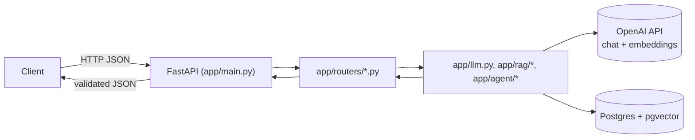
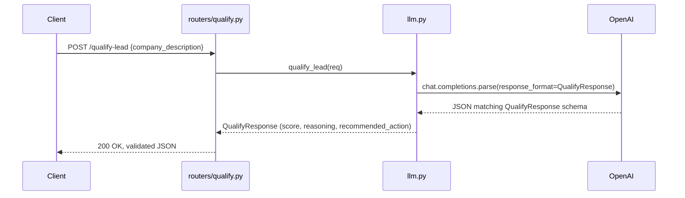
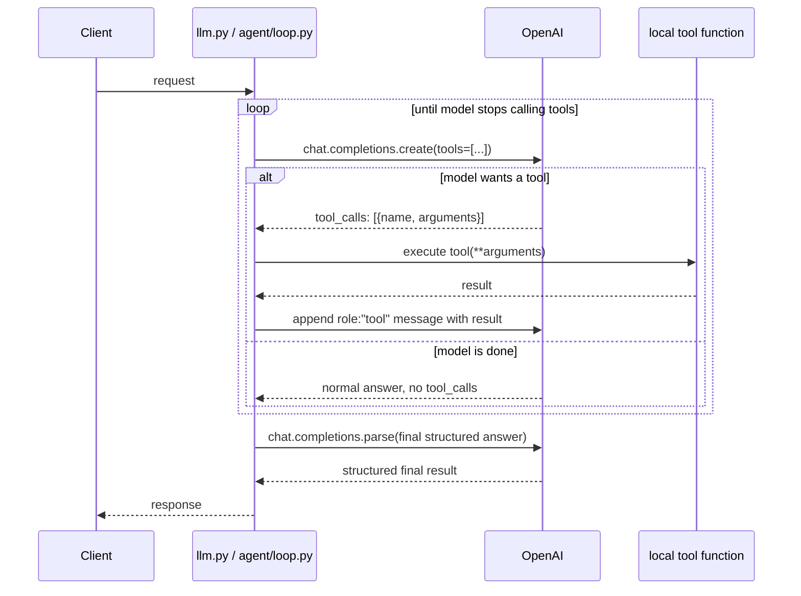
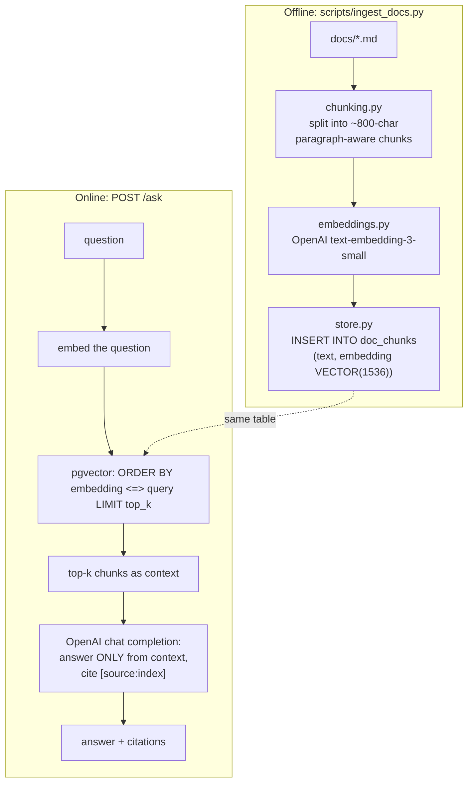

# lead-qualifier-api — Project Study Guide

## 1. Project Overview

`lead-qualifier-api` is a FastAPI service that demonstrates the core building
blocks of production LLM applications: calling an LLM API with **structured
outputs**, giving it **tools** (function calling), building **RAG** (retrieval-
augmented generation) from scratch over a real vector database, and building
an **agent loop** by hand — no LangChain/LangGraph/CrewAI anywhere in this repo.

The problem it solves (mirroring a real B2B sales-automation job description):
given a description of a company, score how good a sales lead it is; given a
question about your own product docs, answer it with citations; given a
company name, research it and draft an outreach email. Every one of those is
implemented as a small, readable HTTP endpoint.

This is the "prove you understand the fundamentals" project that comes before
adopting agent frameworks — the idea being that the raw tool-calling loop and
raw RAG pipeline here are exactly what frameworks like LangGraph wrap, so
debugging framework-based agents later is much easier once you've built one
without a framework.

## 2. System Architecture & Mechanism

At the top level, every request follows the same shape: FastAPI validates the
request with a Pydantic model, a plain Python function does the work (calling
OpenAI as needed), and FastAPI validates + serializes the response with
another Pydantic model.



### 2.1 Structured outputs — `POST /qualify-lead`



The key mechanism: instead of asking the model for free text and hoping it's
valid JSON, `client.beta.chat.completions.parse(..., response_format=QualifyResponse)`
tells the OpenAI SDK to constrain and parse the model's output against the
`QualifyResponse` Pydantic schema *before* your code ever sees it. If the
model can't produce a conforming answer, you get `None`/an error instead of
a corrupted record silently entering your system.

### 2.2 Tool use / function calling — `POST /qualify-lead/with-tools` and `POST /research-lead`



This is the literal mechanism behind every agent framework: the model is
given a list of tool *schemas* (name, description, JSON-schema parameters);
when it decides it needs one, it returns a `tool_calls` list instead of a
normal message; your code executes the named Python function with the given
arguments and appends the result back into the conversation as a `role:
"tool"` message; then you call the model again so it can use that result.
Repeat until the model stops requesting tools, then ask for a final answer.

In this project the "tools" are mocked stand-ins for a real CRM/enrichment
API (Apollo/Clay/HubSpot in the real job description):
- `_lookup_company_firmographics` (in [app/llm.py](app/llm.py)) — fake
  employee-count/industry/funding-stage lookup.
- `_search_company_info` (in [app/agent/loop.py](app/agent/loop.py)) — fake
  industry/size/recent-news lookup.

Swapping either for a real HTTP call to Apollo/Clay/HubSpot would not change
anything else in the loop.

### 2.3 RAG from scratch — `POST /ask`



The core insight RAG relies on: **embeddings** turn text into vectors where
similar *meaning* (not just similar words) ends up close together in vector
space. So a question can retrieve a relevant chunk even with zero word
overlap. `pgvector` is just a Postgres extension that adds a `VECTOR` column
type and a `<=>` (cosine distance) operator — there's no separate vector
database service, retrieval is one SQL query.

### 2.4 The agent loop — `POST /research-lead`

Same tool-calling mechanism as 2.2, applied to a "sales-research agent":
given a company name, the agent calls `search_company_info` at most once,
then produces a two-sentence summary and a draft outreach email as a
structured final answer (`app/agent/loop.py`'s internal `_AgentFinalAnswer`
model), which the router wraps into the public `ResearchLeadResponse`
(adding back `company_name` and the list of tool names actually used).

## 3. Core Components (Project Structure)

```
lead-qualifier-api/
├── app/
│   ├── config.py            # env vars only: OPENAI_API_KEY, OPENAI_MODEL,
│   │                          #   OPENAI_EMBEDDING_MODEL, DATABASE_URL
│   ├── models.py              # every request/response Pydantic schema
│   ├── llm.py                  # OpenAI client wrapper: structured outputs + tool use
│   ├── main.py                   # FastAPI app instance, mounts routers, /health
│   ├── routers/
│   │   ├── qualify.py               # POST /qualify-lead, /qualify-lead/with-tools
│   │   ├── ask.py                    # POST /ask
│   │   └── agent.py                   # POST /research-lead
│   ├── rag/
│   │   ├── chunking.py               # Chunk dataclass + chunk_text()
│   │   ├── embeddings.py              # embed_texts() via OpenAI
│   │   ├── store.py                    # pgvector schema, insert, similarity search
│   │   └── qa.py                        # retrieve -> prompt -> cited answer
│   └── agent/
│       └── loop.py                       # raw while-loop agent (no framework)
├── scripts/
│   └── ingest_docs.py                     # CLI: chunk+embed+store docs/*.md
├── docs/                                    # sample knowledge base for /ask
│   ├── refund_policy.md
│   └── product_overview.md
├── tests/                                    # pytest suite, OpenAI calls mocked
├── Dockerfile                                  # single-stage FastAPI image
├── docker-compose.yml                          # app + pgvector/pgvector Postgres
├── .github/workflows/ci.yml                     # pytest on every push
├── fly.toml                                      # example Fly.io deploy config
├── .env.example                                   # documents required env vars
└── requirements.txt
```

| File | Responsibility |
|---|---|
| [app/config.py](app/config.py) | The only place environment variables are read. Nothing else in the app touches `os.environ` directly. |
| [app/models.py](app/models.py) | `QualifyRequest/Response`, `ToolQualifyResponse`, `AskRequest/Response`, `Citation`, `ResearchLeadRequest/Response` — the full request/response contract of the API. |
| [app/llm.py](app/llm.py) | Owns the OpenAI client (`get_client()`, lazily constructed so importing the module never requires a key), the structured-output call (`qualify_lead`), and the tool-calling call (`qualify_lead_with_tools`) with its mocked `lookup_company_firmographics` tool. |
| [app/rag/chunking.py](app/rag/chunking.py) | Pure function, no I/O: splits text on paragraph boundaries into ~800-character windows with a small overlap, so answers near a chunk boundary don't lose context. |
| [app/rag/embeddings.py](app/rag/embeddings.py) | One function: calls OpenAI's embeddings endpoint for a batch of texts. |
| [app/rag/store.py](app/rag/store.py) | All pgvector SQL: `CREATE EXTENSION`, table schema, insert, and the `<=>` similarity search query. |
| [app/rag/qa.py](app/rag/qa.py) | Wires the above together for `/ask`: embed question -> search -> build a context-only prompt -> ask the model to answer and cite sources. |
| [app/agent/loop.py](app/agent/loop.py) | The hand-rolled agent: system prompt, mocked `search_company_info` tool, and the `while`-style loop (implemented as a bounded `for` loop) that calls the model, executes any requested tools, and repeats until a final structured answer is produced. |
| [scripts/ingest_docs.py](scripts/ingest_docs.py) | Run once (or whenever `docs/` changes) to populate pgvector: `python -m scripts.ingest_docs`. |
| [tests/](tests) | `test_qualify.py`, `test_ask.py`, `test_agent.py` mock the *router-level* functions (e.g. `app.routers.qualify.qualify_lead`), so the suite never calls OpenAI or needs a real key. `test_chunking.py` unit-tests the pure chunking logic with no mocking at all. |

## 4. User Guide (How to Run)

### Option A — local venv (no RAG, since `/ask` needs Postgres)

```bash
cd "D:\Dev\Project Python\lead-qualifier-api"
python -m venv .venv
.venv\Scripts\activate
pip install -r requirements.txt

copy .env.example .env
# then edit .env and set your real OPENAI_API_KEY

uvicorn app.main:app --reload
```

Open http://127.0.0.1:8000/docs for interactive Swagger UI, or call:

```bash
curl -X POST http://127.0.0.1:8000/qualify-lead ^
  -H "Content-Type: application/json" ^
  -d "{\"company_description\": \"A 250-person logistics company evaluating CRM tools.\"}"
```

### Option B — full stack with Docker Compose (recommended, includes pgvector)

```bash
set OPENAI_API_KEY=sk-your-real-key
docker compose up --build
```

Then ingest the sample docs so `/ask` has something to retrieve from:

```bash
docker compose exec app python -m scripts.ingest_docs
```

### Running tests

```bash
pytest -q
```

All 10 tests pass with no API key or network access required, because every
test mocks the OpenAI-calling function at the router boundary rather than
hitting the real API.

### Deploying

See the "Deploying" section of [README.md](README.md) — Railway (auto-detects
the `Dockerfile`) or Fly.io (`fly.toml` included) both work; both need a
Postgres with the `pgvector` extension and your own account credentials to
actually deploy, which is left for you to run.

## 5. AI Concepts Used

- **Structured outputs.** `client.beta.chat.completions.parse(response_format=SomePydanticModel)`
  constrains and validates the model's JSON output against a schema
  server-side, rather than trusting free text and hoping it parses. Used in
  every endpoint that returns a fixed shape (`/qualify-lead`, the final
  answer of `/qualify-lead/with-tools` and `/research-lead`).
- **Tool use / function calling.** Giving the model a list of callable tool
  schemas (`tools=[...]`) and letting it decide when to request one. This is
  the foundation of "agentic" behavior — the model doesn't just generate
  text, it can decide to gather more information before answering.
- **Retrieval-Augmented Generation (RAG).** Solves the problem that LLMs
  don't know your private documents: embed your documents once, embed the
  user's question at query time, retrieve the nearest chunks by vector
  similarity, and paste them into the prompt as grounding context. Built
  here with plain SQL over `pgvector` rather than a framework or a dedicated
  vector-DB service — `pgvector` is literally "Postgres with a vector column
  type and a distance operator."
- **Prompt engineering for reliability, not cleverness.** Every system prompt
  in this repo (`QUALIFY_SYSTEM_PROMPT`, `ASK_SYSTEM_PROMPT`,
  `AGENT_SYSTEM_PROMPT`) exists to constrain output format and behavior
  (score range, "answer only from context," "call the tool at most once"),
  which is what production prompt engineering mostly is.
- **The raw agent loop.** Strip away any framework and an "agent" is just:
  call the LLM with tools -> if it asks for a tool, run it and feed the
  result back -> repeat -> once it stops asking, get the final answer. Every
  framework (LangGraph, CrewAI, AutoGen) adds state management and retries
  on top of exactly this loop.
- **Secrets hygiene.** `app/config.py` is the only place environment
  variables are read; `.env` is git-ignored; `.env.example` documents what's
  required without containing real values. No API key ever appears in code.

## 6. Known Gaps / Honest Notes

- The "tools" (`lookup_company_firmographics`, `search_company_info`) are
  hardcoded mock lookups for two fictional companies ("Acme Corp", "Globex")
  — swapping in a real Apollo/Clay/HubSpot API call would only touch those
  two functions, nothing else in the loop.
- There's no reranking or metadata filtering in the RAG pipeline — it's
  intentionally the simplest version that works, as a learning baseline
  before adding those production refinements.
- No authentication/rate-limiting on the API itself; this is a portfolio/
  learning project, not hardened for public deployment as-is.
